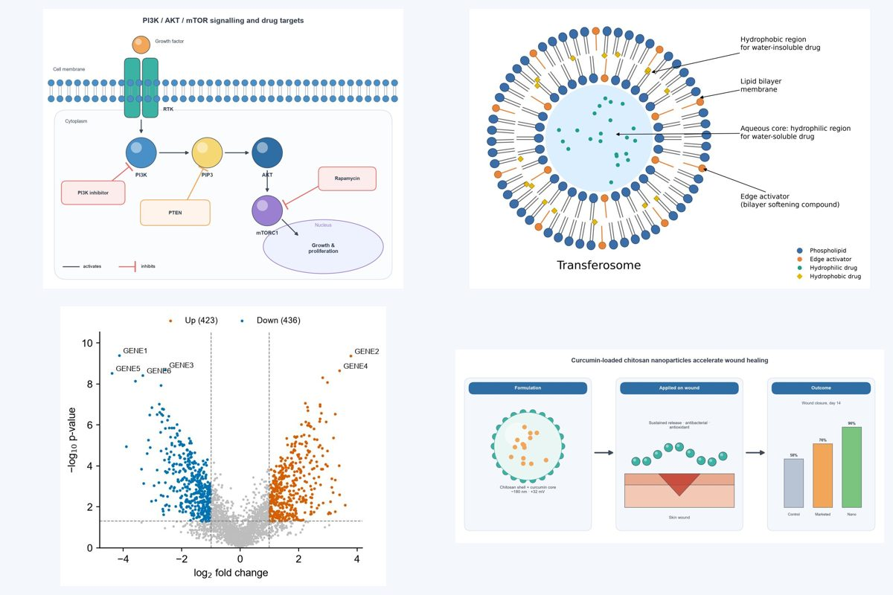
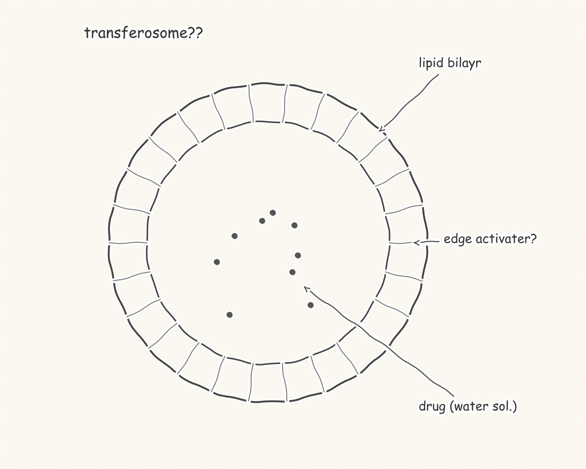
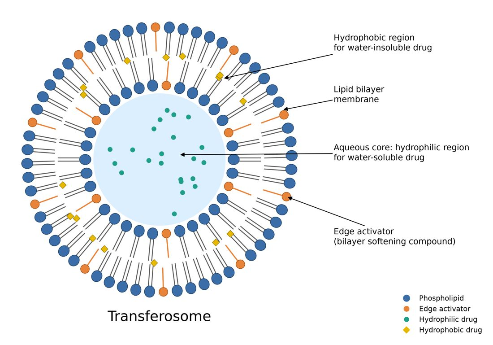
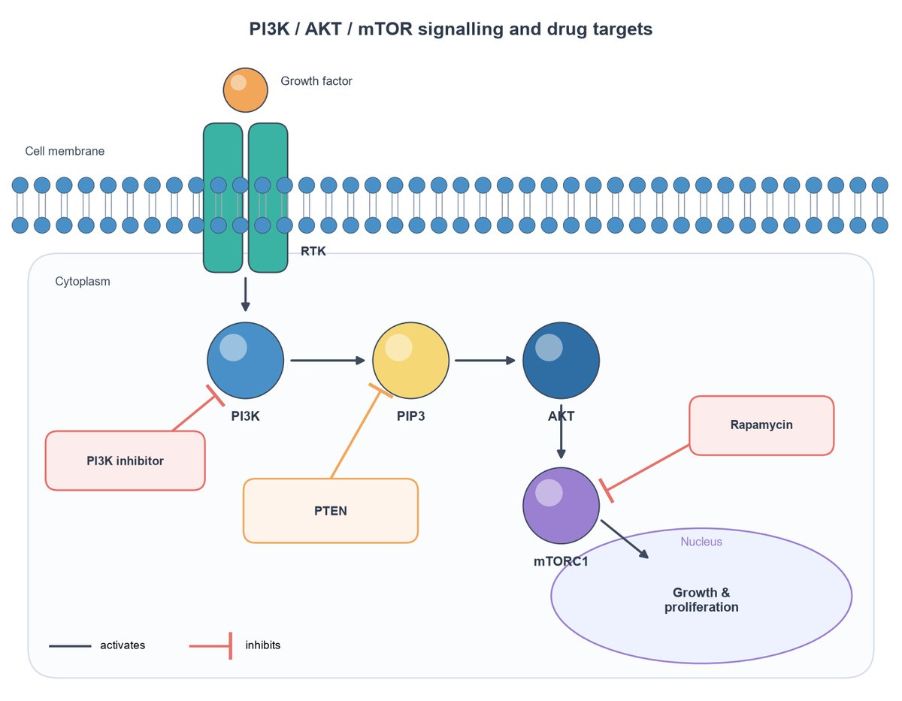
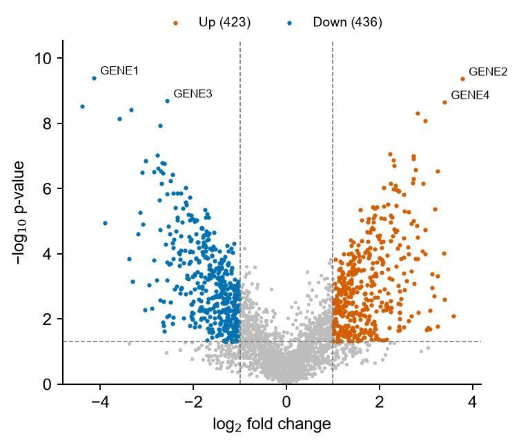
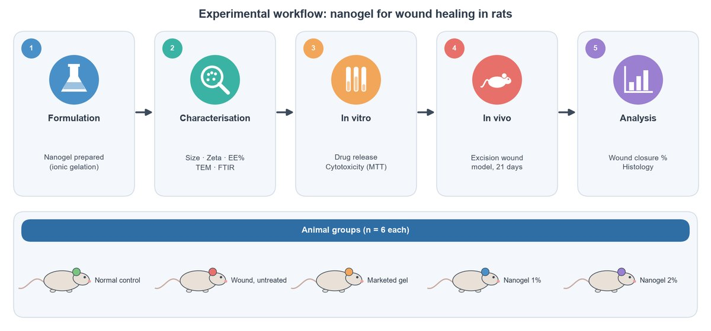
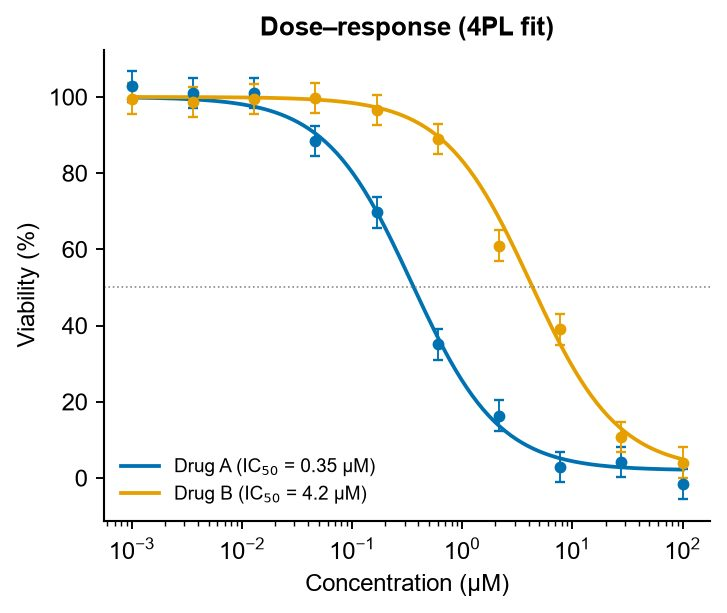

# SciFigures

**AI scientific figure maker that draws publication-ready figures with code.**
Describe a figure, upload a hand-drawn sketch or a messy AI image, or upload CSV/Excel data, and SciFigures
draws a clean, labelled figure: graphical abstracts, signalling pathways, mechanisms of action, labelled
diagrams, flowcharts and journal-style data charts.

🔗 **Live:** [scifigures.in](https://scifigures.in) · free plan, no card needed

## Why code instead of AI pixels

Image generators are fast, but research figures need to be right. SciFigures generates a Python
(matplotlib) script for every figure and runs it, so:

- **Labels are real, spell-checked text** you can edit, not garbled AI lettering
- **Structures and arrows are checked** before you see the figure (activation vs inhibition, compartments, units)
- **Exports are journal-ready:** 300 dpi PNG and TIFF, vector PDF and editable SVG
- **Every figure is reproducible:** download the Python code and redraw it with your own data
- **Edit by chatting:** "make the arrows thicker", "add a label for the nucleus"

Figures are AI-assisted and drawn as code. Follow your journal's rules on disclosing AI-assisted figures.

## Before → after

| Rough sketch | Clean figure |
|---|---|
|  |  |

## Examples

| Signalling pathway | Volcano plot |
|---|---|
|  |  |

| Methodology flowchart | Dose-response curve with IC50 |
|---|---|
|  |  |

## What it makes

- **Diagrams:** graphical abstracts, signalling and metabolic pathways, mechanisms of action, cell and organ
  diagrams, drug-delivery carriers (liposomes, niosomes, transferosomes), methodology flowcharts, timelines, posters
- **Data charts (from CSV/Excel):** bar charts with error bars and significance stars, box and violin plots,
  volcano plots, heatmaps, Kaplan-Meier curves, dose-response curves with IC50, forest plots, PCA plots,
  drug release profiles and more, with Nature / Science / Cell / PLOS / ACS style presets and colour-blind-safe palettes

## Plans

| Plan | India | Elsewhere | Figures |
|---|---|---|---|
| Free | ₹0 | $0 | 3 / month |
| Starter pack (one-time) | ₹149 | $2.49 | 10, valid 90 days |
| Student | ₹499 / month | $7 / month | 50 / month |
| Pro | ₹1499 / month | $19 / month | 200 / month |

Edits are free (up to 10 per figure). Uploads and figures are deleted from the server within an hour.

## Guides

- [How to make a graphical abstract](https://scifigures.in/guides/how-to-make-a-graphical-abstract)
- [Journal figure requirements: size, DPI and file formats](https://scifigures.in/guides/journal-figure-requirements)
- [Free BioRender alternatives](https://scifigures.in/guides/free-biorender-alternatives)
- [Drug release kinetics models](https://scifigures.in/guides/drug-release-kinetics-models)
- [All guides](https://scifigures.in/guides)

## About

Built by **Kuldeep Jatav** (Sjk Labs, India), a lab instructor working with pharmacy and life-science
students, to make clean research figures easy for everyone.

- Website: [scifigures.in](https://scifigures.in)
- Contact: sjklabs.support@gmail.com

*This repository is a showcase. The SciFigures source code is private.*
